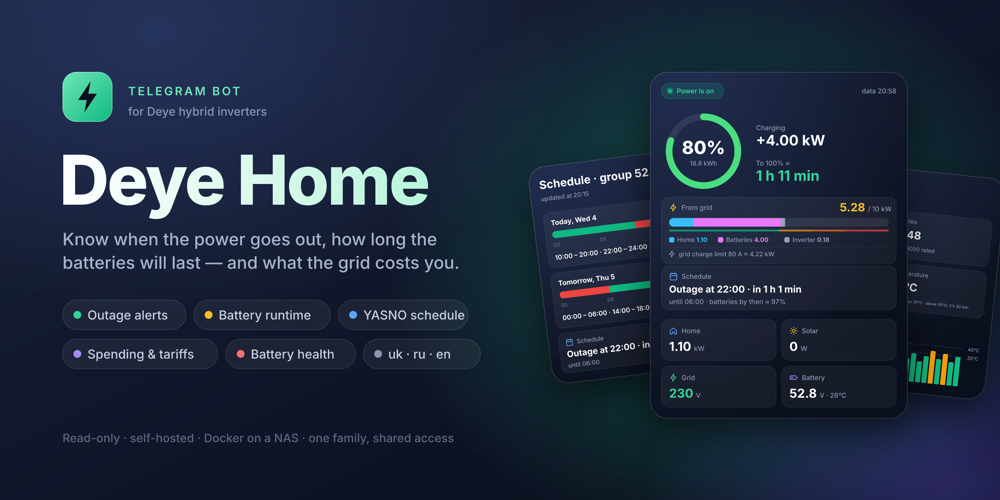
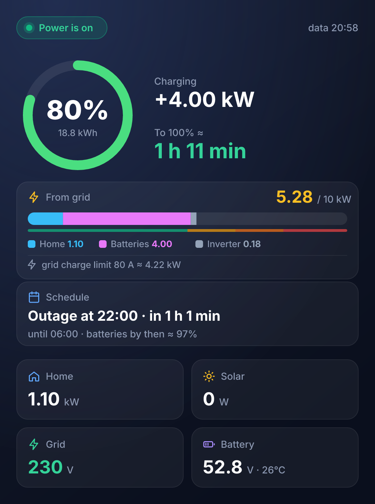
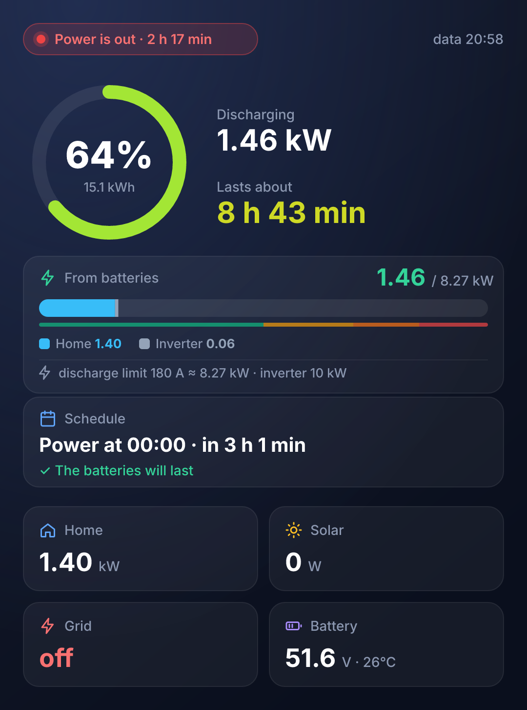
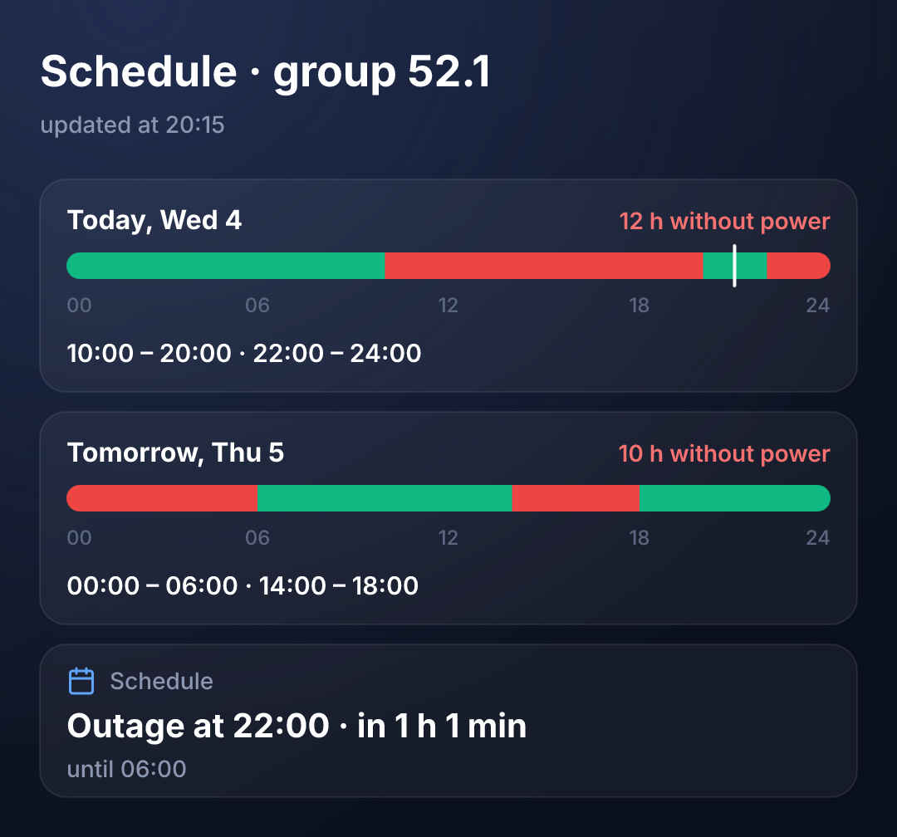
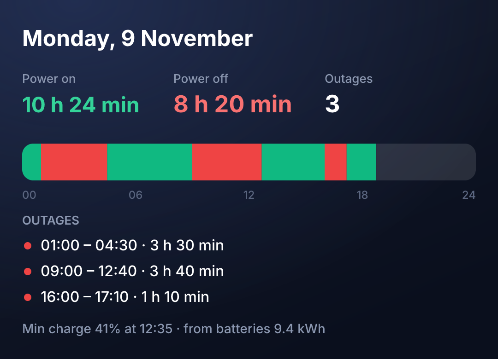
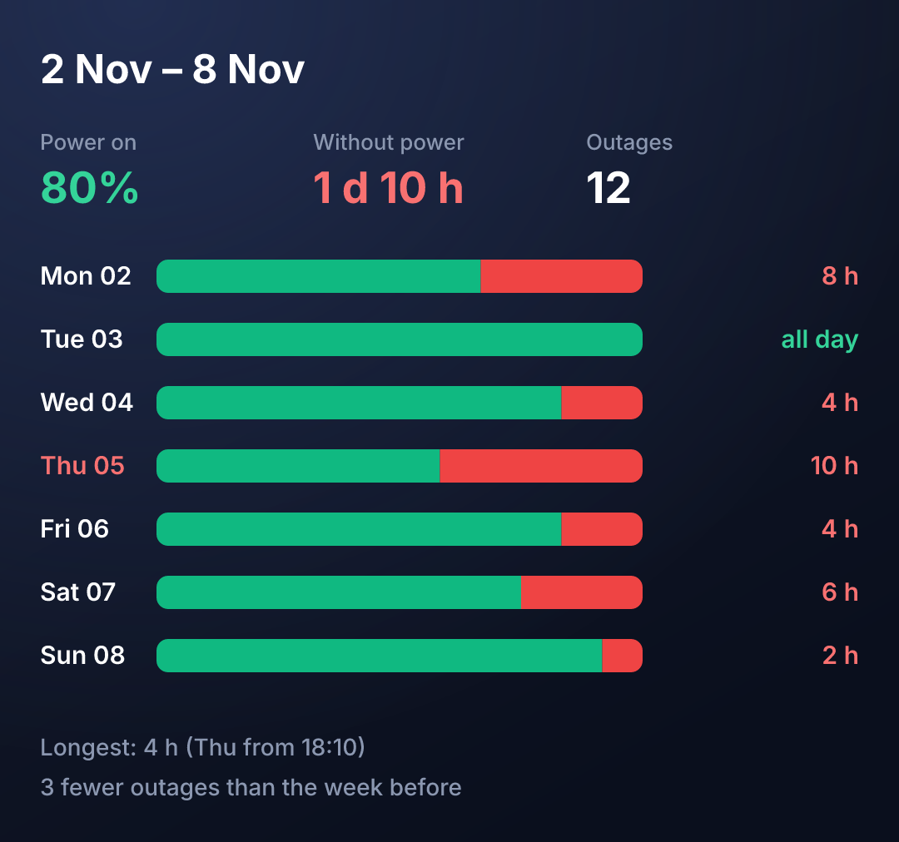
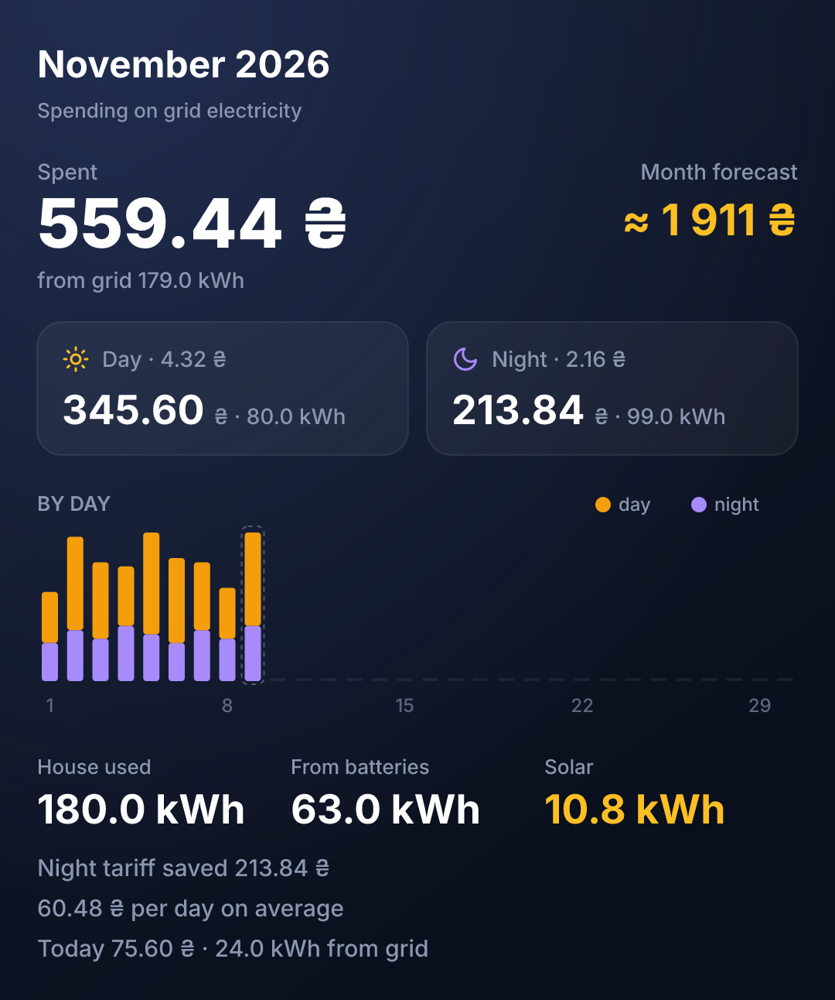
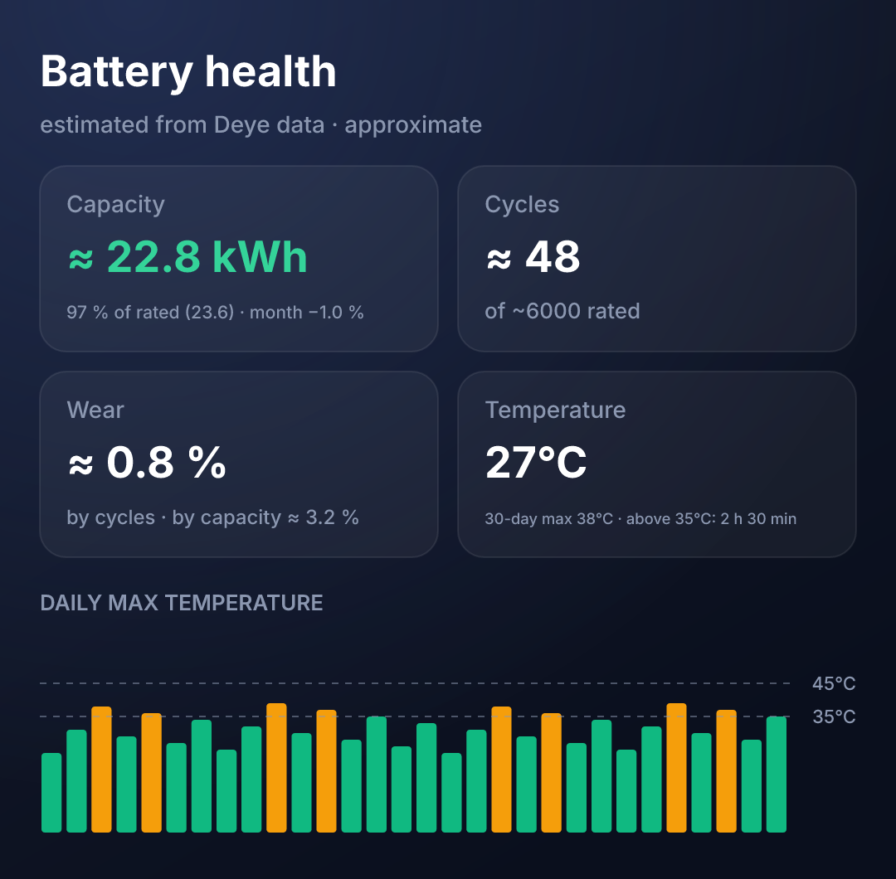

<p align="center">
  
</p>

<p align="center">
  <b>A Telegram bot for a home with a Deye hybrid inverter.</b><br>
  Tells the family when the power goes out and comes back, how long the batteries will last,<br>
  when the next scheduled outage is, and how much the grid costs this month.
</p>

<p align="center">
  
  
  
  
  
  
  
</p>

---

## Contents

- [What it does](#what-it-does)
- [Screens](#screens)
- [Quick start](#quick-start)
- [Deploy to a Synology NAS](#deploy-to-a-synology-nas-docker)
- [Configuration (`.env`)](#configuration-env)
- [In-bot settings](#in-bot-settings)
- [Commands](#commands)
- [Notifications](#notifications)
- [Watchdog](#watchdog-home-offline)
- [Data & backups](#data--backups)
- [Development](#development)
- [License](#license)

---

## What it does

| | |
|---|---|
| 🔴 **Outage alerts** | "Power is out" / "Power is back" within a minute of the logger's next frame, with how long it lasted and which phases dropped. |
| 🔋 **Battery runtime** | Live charge, charge/discharge power, "lasts about…" at the current load, time to 100%, low-charge alerts at the levels you pick. |
| 🗓 **Outage schedule** | Planned outages for your address from YASNO (Kyiv), with reminders before an outage and before power is back, plus "the batteries will / won't last" checks. |
| ⚡ **Grid load** | How much the house and the batteries pull from the grid, with green → red zones and an alert before the main breaker trips. |
| 💰 **Spending** | Monthly cost of grid electricity split by day/night tariff, per-day chart, forecast for the month. |
| 📊 **Statistics** | Day, week and month cards: hours with/without power, every outage, longest outage, week-over-week trend. |
| 🩺 **Battery health** | Estimated real capacity, cycle count, wear, temperature history. |
| 👨‍👩‍👧 **Family access** | Invite-only: anyone who taps `/start` sends a request, the owner approves. Each person picks their own language, sound and night mode. |
| 🛠 **Owner tools** | Bot status, restart, user list, and alerts about Deye cloud problems, overheating, inverter faults and bot errors. |

> [!NOTE]
> The bot only **reads** Deye Cloud. It never sends commands to the inverter.

## Screens

Every card is an image the bot renders itself (SVG → PNG, Inter font). They are shown in the user's language (Ukrainian, Russian or English).

<table>
  <tr>
    <td align="center" width="33%"><br><sub><b>/start</b> — panel, power on, outage ahead</sub></td>
    <td align="center" width="33%"><br><sub>Panel during an outage</sub></td>
    <td align="center" width="33%"><br><sub><b>/schedule</b> — today and tomorrow</sub></td>
  </tr>
  <tr>
    <td align="center"><br><sub>📊 Day statistics</sub></td>
    <td align="center"><br><sub>📅 Week statistics</sub></td>
    <td align="center"><br><sub><b>/money</b> — spending this month</sub></td>
  </tr>
  <tr>
    <td align="center"><br><sub><b>/battery</b> — battery health</sub></td>
    <td colspan="2"></td>
  </tr>
</table>

## Quick start

**You need:** Node.js 24, a Telegram bot token from [@BotFather](https://t.me/BotFather), your Telegram user ID (e.g. from [@userinfobot](https://t.me/userinfobot)) and a Deye Cloud account. For the official API, also an AppID/AppSecret from [developer.deyecloud.com](https://developer.deyecloud.com).

```bash
cp .env.example .env      # fill in the secrets (see Configuration below)
npm ci
npm run discover          # checks Deye API access; writes a redacted tmp/deye-raw.json
npm test && npm run build
npm start
```

Open the bot in Telegram and tap `/start`. The user whose ID is `ADMIN_TELEGRAM_ID` is the **owner**: they get access right away and approve everyone else.

For the outage schedule, the owner sets the home address once: `/settings → ⚙️ Bot settings → 🏠 Address` (street in Ukrainian, then the house). Until then the schedule and its reminders are hidden.

> [!IMPORTANT]
> Run **one** instance per Telegram token. A second copy with the same token will fight the first for updates (the bot warns the owner about it).

## Deploy to a Synology NAS (Docker)

Synology's rsync wrapper refuses plain rsync-over-ssh, so the project is copied as a tar stream:

```bash
# from your computer — replace port, user and host with your NAS
COPYFILE_DISABLE=1 tar czf - --exclude node_modules --exclude dist --exclude .env --exclude data --exclude tmp \
  --exclude .superpowers --exclude .wrangler --exclude ./worker/node_modules --exclude .idea --exclude .DS_Store --exclude .dev.vars . \
  | ssh -p 22 user@nas.local 'mkdir -p /volume1/docker/deye-bot && tar xzf - -C /volume1/docker/deye-bot'
```

On the NAS:

```bash
cd /volume1/docker/deye-bot
# first time only: create .env from .env.example, and a data folder the container (uid 1000) can write to
mkdir -p data && chmod 777 data
sudo docker compose up -d --build
sudo docker compose logs --tail 50
```

**Update:** copy again with the same `tar` command, then `sudo docker compose up -d --build`.

The container restarts by itself (`restart: unless-stopped`), is capped at 512 MB of memory (normal use is ~100 MB) and keeps logs to 3 × 10 MB.

> [!WARNING]
> **Power the NAS, the router and the provider's ONT from the inverter's backup output.** If they go dark with the grid, the bot can't tell anyone about the outage.

## Configuration (`.env`)

All settings live in `.env` (template: [`.env.example`](.env.example)). The bot checks them at startup and refuses to start with a clear message if something required is missing or out of range.

Settings marked **⚙️** are only *defaults*: the owner can change them later right in Telegram (see [In-bot settings](#in-bot-settings)), and the change wins over `.env`.

### Telegram

| Variable | Required | Default | What it is |
|---|:-:|---|---|
| `TELEGRAM_TOKEN` | ✅ | — | Bot token from @BotFather. |
| `ADMIN_TELEGRAM_ID` | ✅ | — | Numeric Telegram ID of the owner. The owner approves access, gets service alerts and can use the owner commands. |

### Deye Cloud

| Variable | Required | Default | What it is |
|---|:-:|---|---|
| `DEYE_SOURCE` | | `official` | `official` uses the Deye OpenAPI (needs AppID/AppSecret). `unofficial` uses the API of the Deye Cloud mobile app. |
| `DEYE_BASE_URL` | | `https://eu1-developer.deyecloud.com/v1.0` | OpenAPI endpoint for your region. |
| `DEYE_APP_ID` | ✅ for `official` | — | App ID from developer.deyecloud.com. |
| `DEYE_APP_SECRET` | ✅ for `official` | — | App secret from developer.deyecloud.com. |
| `DEYE_EMAIL` | ✅ | — | Deye Cloud account login. |
| `DEYE_PASSWORD` | ✅ | — | Deye Cloud account password. |
| `DEYE_STATION_ID` | | auto | Station to watch. Leave empty to pick the account's station automatically. |
| `DEYE_DEVICE_SN` | | auto | Inverter serial number. Leave empty to detect it automatically. |

### Polling and grid detection

| Variable | Default | What it is |
|---|---|---|
| `POLL_INTERVAL_SEC` | `60` | Fallback poll interval, **10–600** s. Normally the bot polls right after each logger frame (about every 3 minutes), so this rarely matters. |
| `STALE_AFTER_MIN` | `15` | If no new data arrives for this long, the bot says "No fresh data from Deye" instead of guessing. Gaps longer than this are shown as "no data" in statistics. |
| `GRID_OFF_VOLTS` | `50` | A phase below this voltage counts as **missing**. Any missing phase means an outage: a 3-phase Deye switches to batteries when one phase fails. |
| `GRID_OK_VOLTS` | `180` | A phase above this voltage counts as **normal**. Voltage between the two thresholds is treated as uncertain, so a sagging grid doesn't spam alerts. |

### Battery

| Variable | Default | What it is |
|---|---|---|
| `BATTERY_CAPACITY_KWH` | `24` | Rated battery capacity, kWh. Used only if Deye doesn't report the capacity itself. |
| `BATTERY_RESERVE_PCT` ⚙️ | `10` | Charge that is never counted as usable. "Lasts about…" and "will the batteries last" stop at this level. |
| `BATTERY_THRESHOLDS` ⚙️ | `50,30,20,10` | During an outage, everyone gets an alert when the charge drops to each of these levels (%). Comma-separated. |
| `BATTERY_RATED_CYCLES` | `6000` | Rated cycle life of the battery, **500–20000**. Used for the wear estimate on `/battery`. |

### Owner alerts

| Variable | Default | What it is |
|---|---|---|
| `BATTERY_TEMP_MAX_C` ⚙️ | `45` | Battery overheating alert, °C. |
| `INVERTER_TEMP_MAX_C` ⚙️ | `70` | Inverter overheating alert, °C. |
| `GRID_LOAD_MAX_KW` ⚙️ | `8` | Alert (owner only) when the house + battery charging + the inverter's own share draw this much from the grid, kW. The red zone on the panel starts here; the bar's scale is the inverter's rated power (10 kW). The all-clear comes 0.5 kW lower. |
| `BATTERY_LOAD_MAX_KW` ⚙️ | `7` | Alert (everyone) when the house draws this much from the batteries during an outage, kW. The red zone starts here; the bar's scale is what the inverter can give: max discharge current × battery voltage × 0.89, capped by its rating. The all-clear comes 0.5 kW lower. |
| `GRID_CHARGE_A` ⚙️ | `80` | Grid charge current set on the inverter (**Batt set2 → Grid Charge**), A. Deye Cloud doesn't report it, so set it here; the panel shows the charge limit from it. |
| `CLOUD_DOWN_AFTER_MIN` ⚙️ | `10` | How long the Deye cloud has to stay unreachable before the owner hears "Deye cloud not responding". |

### Tariff

| Variable | Default | What it is |
|---|---|---|
| `TARIFF_DAY` ⚙️ | `4.32` | Day price, ₴/kWh. |
| `TARIFF_NIGHT` ⚙️ | `2.16` | Night price, ₴/kWh. Set to `none` for a single-rate meter. |
| `TARIFF_NIGHT_FROM` ⚙️ | `23` | Hour the night tariff starts. |
| `TARIFF_NIGHT_TO` ⚙️ | `7` | Hour the night tariff ends. |

### Night mode, time zone, storage

| Variable | Default | What it is |
|---|---|---|
| `QUIET_FROM` ⚙️ | `23` | Start of night mode. People who turned night mode on get notifications **silently** in these hours. |
| `QUIET_TO` ⚙️ | `7` | End of night mode. |
| `TZ_NAME` | `Europe/Kyiv` | IANA time zone for all times, days and tariffs. |
| `DB_PATH` | `./data/deye.db` | SQLite database file. In Docker it is fixed to `/app/data/deye.db` (the `./data` folder). |

### Watchdog (optional)

| Variable | Default | What it is |
|---|---|---|
| `WATCHDOG_URL` | empty (off) | URL of your Cloudflare watchdog worker, must be `https://`. See [Watchdog](#watchdog-home-offline). |
| `WATCHDOG_SECRET` | empty | Shared secret the bot sends with each check-in. Same value as the worker's `BEAT_SECRET`. |

## In-bot settings

### For everyone — `/settings`

| Button | What it does |
|---|---|
| 🔔 Sound | Notifications with or without sound. |
| 🌙 Night mode | Notifications arrive silently during the night-mode hours (23:00–07:00 by default). |
| 🛰 «Home offline» | Get a message from the [watchdog](#watchdog-home-offline) if the house loses internet or the NAS goes off. On for the owner by default. |
| ⚡ Before an outage | Reminder before a scheduled outage: off → 15 → 30 → 60 min (tap to cycle). Shown once an address is set. |
| 💡 Before power is back | Reminder before power is due back by the schedule: off → 15 → 30 → 60 min. |
| 🌐 Language | Українська, Русский or English. New users get their Telegram language (anything else → English). |
| 🚪 Leave the bot | Stop notifications and remove yourself from the user list. |

### For the owner — `/settings → ⚙️ Bot settings`

Changes are saved in the database and applied **immediately**, no restart. Each value shows its `.env` default, and **↩️ Default** goes back to it.

| Section | Setting | Choices |
|---|---|---|
| 💰 Tariff | Day price | 4.32 or any price you type |
| | Night price | 2.16, any price you type, or *single-rate* |
| | Night from / until | 20:00–00:00 / 05:00–09:00 |
| 🔋 Battery | Charge alerts | any of 80 / 70 / 60 / 50 / 40 / 30 / 20 / 15 / 10 / 5 % |
| | Charge reserve | 0 / 5 / 10 / 15 / 20 / 30 % |
| 🌡 Overheating | Battery | 35 / 40 / 45 / 50 / 55 °C |
| | Inverter | 60 / 65 / 70 / 75 / 80 / 85 °C |
| ⚡ Grid load | Warn from | 5 / 6 / 6.5 / 7 / 7.5 kW |
| 🌙 Night mode | Silent from / until | 20:00–00:00 / 05:00–09:00 |
| 🛠 Service | «Cloud not responding» after | 5 / 10 / 15 / 30 / 60 min |
| 🏠 Address | Street and house for the YASNO schedule | search by street (in Ukrainian), then pick the house; the bot finds the group |

## Commands

| Command | Who | What it shows |
|---|---|---|
| `/start` | everyone | The panel: grid state, battery, load, solar, next scheduled outage. Buttons: 🔄 Refresh, 📊 Statistics, 💰 Spending, 🗓 Schedule. |
| `/schedule` | everyone | Outage schedule for today and tomorrow (refresh at most once a minute). |
| `/money` | everyone | Spending on grid electricity this month, with ‹ › to switch months. |
| `/battery` | everyone | Battery health: capacity, cycles, wear, temperatures. |
| `/settings` | everyone | Personal settings (and ⚙️ Bot settings for the owner). |
| `/users` | owner | Who has access; approve, reject or remove people. |
| `/status` | owner | Bot health: uptime, cloud lag, next poll, errors in the last 24 h, inverter faults, temperatures, DB size, memory. |
| `/restart` | owner | Restarts the bot (Docker brings it back; a local `npm start` just stops). |

## Notifications

**Everyone with access:**

- 🔴 Power is out (which phases are missing, how long the batteries will last)
- 🟢 Power is back (how long it was out, charging speed, time to 100%)
- 🪫 Battery dropped to a threshold during an outage · 🔋 Batteries full
- ⚠️ The batteries may not last until power is back by schedule / until morning — with the load to stay under
- ⚡ / 💡 Schedule reminders · 🗓 YASNO moved the address to another group
- ⚠️ No fresh data from Deye / ✅ data is back

**Owner only:**

- 🟢 Bot started (first start, after a restart, after a crash — with downtime)
- ⚠️ Deye cloud not responding · 🔑 Deye rejects the keys
- 🌡 Battery or inverter overheating · 🚨 Inverter fault
- ⚠️ High grid load · 🐞 Bot errors (repeats within an hour are summed up) · 💾 Backup failed
- 🔒 Access requests from new users

## Watchdog («Home offline»)

If the house loses internet, the bot can't report it itself. [`worker/`](worker/README.md) is a small Cloudflare Worker (free plan is enough): the bot checks in every 3 minutes, and if check-ins stop for 10 minutes the worker sends a message through the same Telegram bot to everyone who turned on 🛰 «Home offline». When check-ins resume, it says the home is back online.

Setup: [`worker/README.md`](worker/README.md), then set `WATCHDOG_URL` and `WATCHDOG_SECRET` and restart the bot.

## Data & backups

- Everything lives in **`./data`** (SQLite).
- Readings, outages and daily energy are kept for **90 days**. Battery-health history is small and kept permanently.
- Every night at **03:30** the bot writes a compressed copy to `data/backups/deye-YYYY-MM-DD.db.gz` and keeps the last **90 days**. If a backup fails, the owner is told.

To move the bot to another machine, copy `data/` and `.env`.

## Development

```bash
npm test               # vitest
npm run typecheck
npm run build          # → dist/
npm run discover       # raw Deye API responses (secrets redacted) → tmp/deye-raw.json
npm run readme-assets  # re-render the README images in docs/readme/ from the real card code
```

| Path | What's there |
|---|---|
| `src/deye/` | Deye Cloud clients (official OpenAPI and the app API) |
| `src/domain/` | Grid state, statistics, forecasts, load, energy |
| `src/schedule/` | YASNO outage schedule: API, model, reminders |
| `src/render/` | Card models and SVG templates → PNG via resvg |
| `src/bot/` | Telegram handlers, keyboards, message texts |
| `src/i18n/` | Ukrainian, Russian and English dictionaries |
| `src/storage/` | SQLite schema and repository |
| `worker/` | Cloudflare watchdog worker |
| `docs/` | Specs, plans, Deye field notes |

Design specs: [`docs/superpowers/specs/`](docs/superpowers/specs/).

## License

[MIT](LICENSE) © 2026 Denys Bielov
